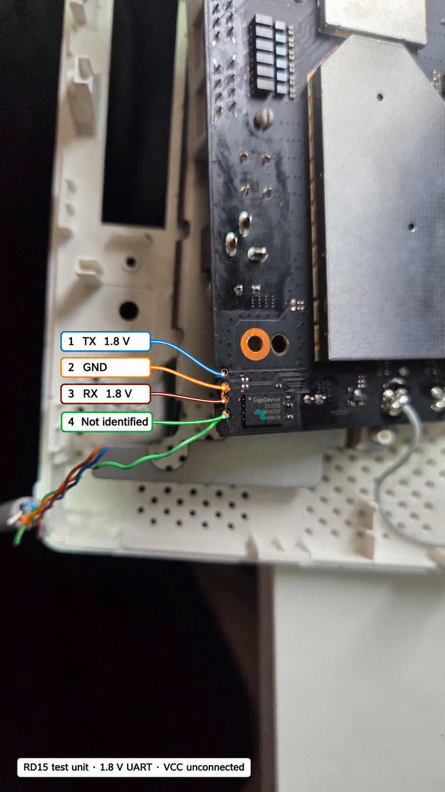

# Hardware notes — Xiaomi BE3600 2.5G (RD15)

Facts below come from the stock 1.0.87 device tree, the stock bootloader's
output and a running unit. "Observed" means seen on one unit only.

## Main parts

| Part | Detail |
|---|---|
| SoC | Qualcomm IPQ5332 (4 × Cortex-A53), reference board AP-MI04.1-C2 — the same reference board as the GL.iNet GL-BE3600, which is why that tree is the base |
| RAM | 256 MiB DDR. U-Boot fixes `/memory` to `0x40000000 + 0x10000000`. After the Q6 (Wi-Fi) carve-outs Linux has roughly 145 MiB |
| Flash | SPI-NAND GD5F1GM7REYIG, 128 MiB, 2048 B pages, 128 B OOB, 128 KiB blocks, on QPIC. Host ECC **8 bit / 512 B** (4/512 gave `-EBADMSG`) |
| 2.4 GHz | IPQ5332 integrated radio, board-id `0x13` |
| 5 GHz | QCN6432 (AHB, user PD 2), board-id `0x60` |
| Switch | Motorcomm YT9215S at MDIO `0x1d`. LAN1–3 = internal PHYs 1–3. CPU on external port 8, 2500base-x fixed link to PPE port 2 |
| 2.5 GbE port | A prior stock-side read on this unit found Motorcomm **YT8821** (id `0x4f51ea19`) at MDIO `0x07`, with no response at `0x0c`. The stock DTB lists both that address and QCA8081 at `0x0c`, and the stock scripts select a driver based on which PHY is present. PPE port 1 is omitted from this OpenWrt DTS; link and throughput are untested here |
| Buttons | reset = GPIO43, "mesh" (WPS) = GPIO35, both active low |
| MDIO reset | GPIO51 resets the whole bus (switch + PHYs). It idles as an input with pull-down, so the YT9215S stays in reset unless something releases it |
| Serial | 115200 8N1, **1.8 V logic** |

## Serial console

The console is a 1.8 V UART. A 3.3 V or 5 V adapter can damage the SoC.
Connect GND, router TX → adapter RX and router RX → adapter TX; leave VCC
unconnected. On the one RD15 board photographed below, the four pads are
beside the GigDevice chip at the PCB corner. In the **orientation shown in
the photo**, top to bottom:

| Pad | Photo wire | Observed function | Evidence |
|---|---|---|---|
| 1 | Blue | Router TX, 1.8 V logic | Boot output received by the adapter |
| 2 | Orange | GND | Continuity to the 1 GbE port shields |
| 3 | Brown | Router RX, 1.8 V logic | Adapter TX interrupted autoboot and reached `IPQ5332#` |
| 4 | Green | **Unidentified** | No confirmed serial function; it may be a supply pin, but this was not verified |

[Original, unannotated photograph](images/rd15-uart-original.jpg). The
annotation was generated from that photograph and checked against the UART
test log; use the original to inspect the actual solder pads. These are
observations on **one board**, not a guarantee for every hardware revision.
Verify GND and logic voltage on your unit with a meter before connecting.
**Do not connect pad 4 or the adapter VCC.**

The stock firmware ships with the console and the autoboot interrupt
**disabled** (`uart_en=0`, `boot_wait=off` in Xiaomi nvram); U-Boot then
prints only up to SBL1/APPSBL. See [installing.md](installing.md).

## Flash layout (from SMEM; stock 1.0.87)

Relevant partitions (Linux numbering on the tested unit):

| mtd | Name | Notes |
|---|---|---|
| 2 | `0:MIBIB` | partition table — **never write** |
| 14/15 | `0:APPSBL` / `0:APPSBL_1` | U-Boot — **never write** |
| — | `0:APPSBLENV` | U-Boot environment, 64 KiB at offset 0, single copy; holds the slot flags |
| 17 | `0:ART` | **per-unit** Wi-Fi calibration and MAC addresses — never write, never share |
| 19 | `rootfs` | **slot 0**, `0x2a00000` bytes (42 MiB), UBI |
| 20 | `rootfs_1` | **slot 1**, same size, UBI |
| 21 | `bdata` | Xiaomi board data (region, serial…) — never write, never share |

Stock UBI volumes in each slot: `kernel` (static, 83 LEBs = 10,539,008 B,
holds the FIT) and `ubi_rootfs` (193 LEBs = 24,506,368 B, SquashFS). This
port keeps those names so the stock bootloader still finds them, shrinks
`ubi_rootfs` to 16 MiB and adds `rootfs_data` (UBIFS overlay) with the rest.

## Boot flow

1. SBL1 → APPSBL (stock U-Boot). `bootcmd=bootmiwifi`.
2. `bootmiwifi` picks the slot from `flag_boot_rootfs` (0 = `rootfs`,
   1 = `rootfs_1`) and passes `ubi.mtd=rootfs` or `ubi.mtd=rootfs_1` to the
   kernel, then loads the `kernel` volume and boots FIT configuration
   `config@mi04.1-c2`.
3. It **counts a failed try on every boot** (`flag_try_sys*_failed`,
   `flag_boot_success`, `flag_last_success`) and falls back to the other slot
   unless the running OS marks success, which the Xiaomi firmware does in its
   `boot_check`. This port does the same with `rd15-slot mark-good`, started
   by `/etc/init.d/rd15-slot` once the LAN interface is up.
4. The OpenWrt DTB appends `ubi.block=0,ubi_rootfs root=/dev/ubiblock0_1`;
   the later `root=` overrides the stock one.

`bootm` on a FIT loaded by hand resets the SoC (`HLOS Panic`) on this
bootloader even with the stock FIT; the preamble of `bootmiwifi` is needed.
[installing.md](installing.md) shows how the RAM boot works around that.

## Reserved memory (stock 256 MiB "Q6" profile)

`0x4a900000–0x4cc00000` root PD code + PD1 data (`q6_region`), then m3/ETR
dump regions, `0x4ce00000` 16 MiB QCN6432 data, MLO memory at `0x4e000000`.
The stock DTB has no caldb regions; ath12k needs the handles, so the port
carves 5 MiB each at `0x4f000000` and `0x4f500000`. See the DTS.

## Wi-Fi firmware boot arguments

The stock DTB uses Q6 `boot-args = <1 4 3 1 0x2f 2>` with its 1.3 firmware.
With the WLAN.WBE.1.4 root PD of the base tree that made PD2 die with
`err_smem_ver`; the GL-BE3600 value `<1 5 3 1 0x2f 2 0>` works.
